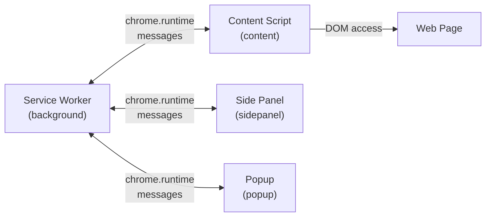

# Architecture Overview

## Overview

ReadNote is a Chrome Extension (Manifest V3) built with vanilla ES Modules. It follows a layered, modular architecture with strict separation of concerns between the extension contexts.

---

## Extension Contexts



| Context | File | Responsibilities |
|---|---|---|
| Service Worker | `src/background/` | Lifecycle, message routing, context menus, auth |
| Content Script | `src/content/` | DOM access, extraction, selection, highlighting |
| Side Panel | `src/sidepanel/` | Main reading UI, notes, summary display |
| Popup | `src/popup/` | Quick actions launcher |

---

## Layer Architecture

```
┌──────────────────────────────────────┐
│           UI Layer                   │
│  popup / sidepanel / components      │
├──────────────────────────────────────┤
│          Module Layer                │
│  reader / notes / highlights / ai   │
├──────────────────────────────────────┤
│          Service Layer               │
│  ApiClient / AuthService / Sync      │
├──────────────────────────────────────┤
│          Storage Layer               │
│  StorageManager / IndexedDB / Local  │
├──────────────────────────────────────┤
│          Shared Layer                │
│  constants / utils / errors          │
└──────────────────────────────────────┘
```

---

## Data Flow

1. User triggers action (popup button or context menu)
2. Background service worker receives message
3. Background delegates to appropriate module
4. Module calls content script if DOM access is needed
5. Result is returned to side panel for display
6. Data is persisted via StorageManager

---

## Storage Strategy

| Data | Backend | Reason |
|---|---|---|
| Notes, highlights, settings | `chrome.storage.local` | Simple, sync-able, up to 10MB |
| Large page content | `IndexedDB` | Unlimited, structured |
| Auth token | `chrome.storage.session` | Cleared on browser close |
